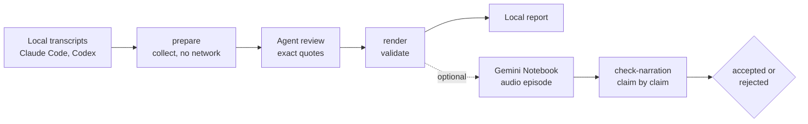

# Agent Game Tape

[](https://github.com/Leit-motif/agent-game-tape/actions/workflows/tests.yml)
[](LICENSE)

**Review your human–AI sessions like an athlete reviews game tape.**

Your coding-agent transcripts already record every call you made: the clear instruction that paid off,
the vague one that cost a rework, the "done" you never checked. Agent Game Tape turns a day of those
sessions into a short, evidence-backed debrief so you get better at steering AI.

The local report is the product. Every lesson cites exact quotes and events from your own sessions. An
optional Gemini Notebook (formerly NotebookLM) audio episode can retell it. Audio is experimental: each
episode is checked claim by claim against the evidence (`check-narration`) and delivered only if it passes.

## Quickstart (about 60 seconds)

You need Python 3.10+ and [Claude Code](https://docs.claude.com/en/docs/claude-code). There are no
Python dependencies and no API keys.

**1. Clone and install as a Claude Code skill.** Keep the clone; the skill link points at it.

```bash
git clone https://github.com/Leit-motif/agent-game-tape.git
cd agent-game-tape
mkdir -p ~/.claude/skills
ln -s "$(pwd)" ~/.claude/skills/agent-game-tape
```

**2. Check your setup.** `doctor` writes nothing and makes no network calls of its own (it asks the
`claude` CLI for its version and login status). It tells you what is missing and what to do next.

```bash
python3 scripts/game_tape.py doctor
```

**3. Try the demo.** Entirely fictional data, no account, no network.

```bash
python3 examples/make_demo.py --out /tmp/game-tape-demo
python3 scripts/game_tape.py render /tmp/game-tape-demo/case-a
open /tmp/game-tape-demo/case-a/report.md   # or any Markdown viewer
```

The demo shows one good call (a regression check that kept a rewrite off the table) and one agent
failure (publishing before a preview check the human had asked for). Its
[fact sheet](examples/fact-sheet.md) spells out what the record does and does not support.

**4. Review your own sessions.** Start or restart Claude Code, then ask:

```text
/agent-game-tape review yesterday's sessions
```

On first use the skill runs `doctor` and walks you through anything missing. Reports are written under
`~/.agent-game-tape` (override with `$GAME_TAPE_HOME`), never inside the repository.

<details>
<summary>Using Codex instead (or as well)</summary>

```bash
cd agent-game-tape   # your clone
mkdir -p ~/.agents/skills
ln -s "$(pwd)" ~/.agents/skills/agent-game-tape
```

Then ask Codex: `$agent-game-tape review yesterday's sessions`. For project-scoped installs, use
`.claude/skills/` or `.agents/skills/` inside that project. OpenClaw exports are also supported. See
[hosts and transcript adapters](references/adapters.md).

</details>

## How it works



The agent you already use does the reading and judgment. The Python helpers do the deterministic parts:
collection, exact-quote validation, rendering, the optional audio upload, and the claim check.

## What you get

- A private report with zero to five moments that changed an outcome, each tied to your exact words
  and the events that followed.
- Human steering separated from agent execution and system failures. A bad result is not automatically
  your bad call.
- At most one concrete experiment for your next session, with a way to tell whether it worked.
- An honest abstention on a quiet or thin day instead of an invented fault.
- A narration-ready source file that leaves out the raw transcript, rules and audit labels.

## Audio (optional)

Audio needs the separate [`notebooklm-mcp-cli`](https://github.com/jacob-bd/gemini-notebook-mcp-cli)
client (`nlm`), installed and logged in by you. The calling agent chooses the controls at render time.
They mirror the Customize Audio Overview dialog:

| Control | Values | Default |
|---|---|---|
| `--format` | `deep_dive`, `brief`, `critique`, `debate` | `deep_dive` |
| `--length` | `short`, `default`, `long` | `default` |
| `--language` | language code, e.g. `en`, `es`, `ja` | `en` |
| `--source PATH` | repeatable; extra files to upload. `narration` means the rendered narration | narration only |
| `--focus TEXT` or `--focus-file PATH` | your focus prompt | bundled coaching focus |

Web research ("discover sources") is always off. Outside facts Gemini Notebook pulls in carry no evidence
ids, so the episode could no longer be checked claim by claim against your sessions. Raw evidence,
`review.json` and rules files are refused as sources.

```bash
python3 scripts/game_tape.py render RUN --format brief --length short
python3 scripts/notebooklm.py start RUN --allow-upload
python3 scripts/notebooklm.py wait RUN --download
# transcribe RUN/audio.m4a locally (e.g. whisper, JSON output), then:
python3 scripts/game_tape.py check-narration --run RUN \
  --transcript RUN/audio.json --out RUN/narration-check.json
```

Upload happens only with `--allow-upload`, and only the sources recorded in the run's manifest. Each
audio request is sent at most once, so a network error never silently creates duplicate episodes.
`check-narration` exits 0 for `accepted` and 1 for `rejected` or `unverified`. Exact minutes, fixed
voices and verbatim scripts are not controls the service offers. Details:
[Gemini Notebook controls and execution](references/notebooklm.md) and
[full-episode QA](references/audio-qa.md).

## How we know the checker works

The narration checker was evaluated against a pass bar written down before it was ever run: catch
every labelled failure, flag no faithful claim, and give the same verdict on every repeat. On the
second round it cleared that bar:

| Measure | Result |
|---|---|
| Labelled failures caught | 48/48 |
| Faithful claims falsely flagged | 0/969 |
| Accept/reject decisions correct | 54/54 |
| Cases stable across three runs | 18/18 |

The cases include two real Gemini Notebook episodes, both of which human review had rejected for
embellishment. The checker rejected both in every run, for the reasons human review found.

This is a small development set built from fictional sessions: two scenarios,
Brief-length episodes, and no held-out set. Treat the result as directional. A rejection is actionable;
an acceptance is strong evidence, not proof.

## Audio status: experimental, gated per episode

Gemini Notebook still embellishes, for example by turning an eight-minute gap into "an 8-minute rollback"
or calling an untouched table "protected". In a pre-registered study on three fictional cases, naming the
literal first sentence in the Brief focus fixed the opening (0 of 8 episodes before, 6 of 6 after) and is
now the default. With it, 2 of 5 Brief episodes passed the checker (both after a checker fix, made once
the results were in, that stopped a spoken title line from making an episode `unverified`). Changes aimed at
the remaining invented durations and savings showed no gain. 6 of 20 audio requests came back ambiguous,
and each of those ended `failed` with no audio; the cause is unknown.

So the skill treats every episode as unproven until it is checked. If `check-narration` accepts the
episode, you get the audio with its receipt. If it does not, you are told why and offered one
regeneration or the local report alone; an unchecked episode is never delivered. These numbers come
from small fictional samples and are directional only. Full method and results:
[narration climb](references/narration-climb.md), [checker evaluation](references/checker-eval.md),
[validation record](references/validation.md).

## Privacy

- `prepare` and `render` make no network calls. `doctor` makes none of its own and counts transcript
  files without reading them; `--probe-model` adds one tiny Claude call.
- `check-narration` sends the transcript, evidence and review to Anthropic through your `claude` CLI
  login, under that account's data policy.
- Runs live under `~/.agent-game-tape`, outside the repository.
- The coding agent reading your evidence sees it under that host's normal data policy.
- `--allow-upload` sends only the selected sources and focus prompt to your own Google account. Read them
  first. Secret redaction is best-effort, not a guarantee.
- The skill installs no schedules, never shares notebooks publicly, and never reads browser cookies.

## Limits

- Transcript formats change. Check the coverage report before reading an empty day as a quiet one.
- Python validates structure and exact quotes, not semantic truth or who caused what. Read the report.
- The checker reads a transcript, not sound. ASR errors can look like narration errors.
- The audio client uses undocumented Google endpoints and may break when Google changes them.

## Models

The narration checker runs through your local Claude Code login. The tested model is
`claude-opus-5-5`, set in [`scripts/models.py`](scripts/models.py). `check-narration --model` accepts
another model, but the receipt and output then mark the result `unvalidated`: the evaluation above
covers the tested model only.

## Contributing

Issues and small pull requests are welcome. See [CONTRIBUTING.md](CONTRIBUTING.md) and the
[changelog](CHANGELOG.md).

## License

[MIT](LICENSE). Not affiliated with Google, Anthropic or OpenAI.
